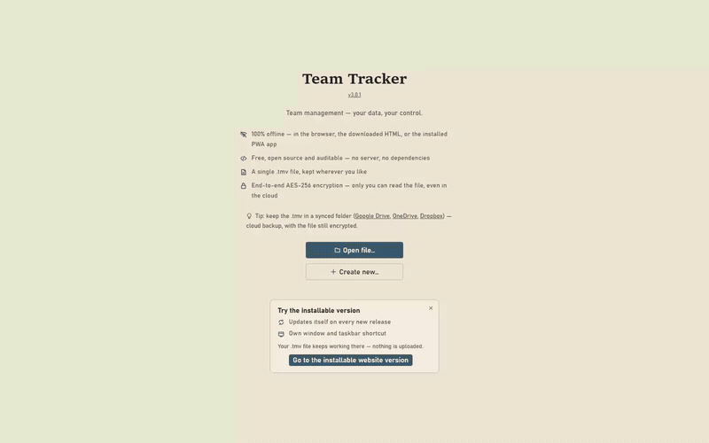
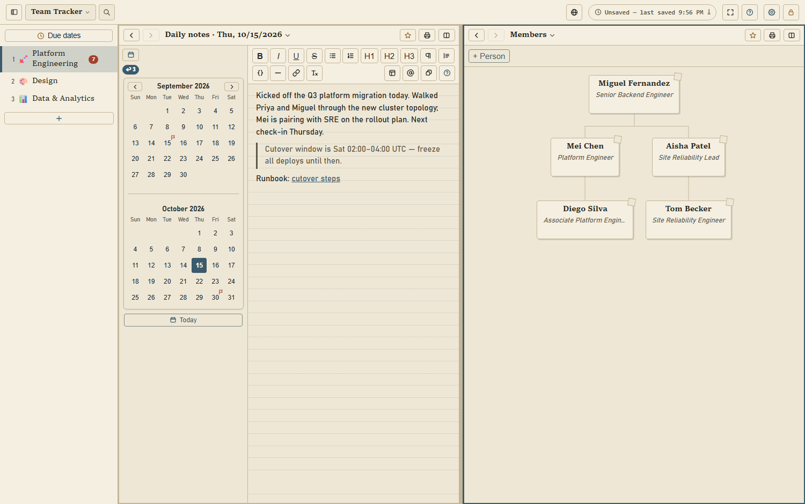
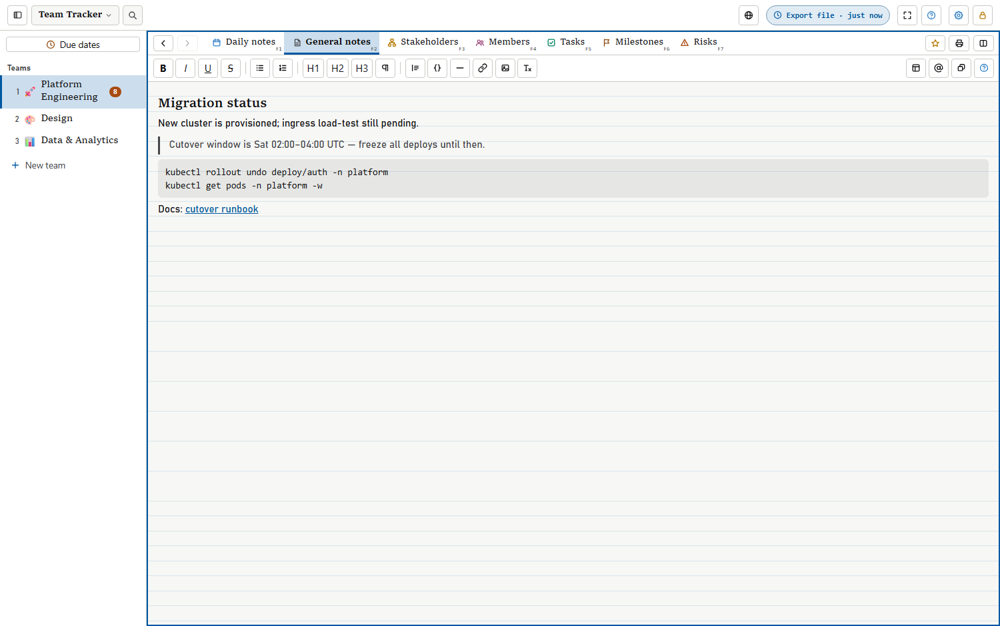
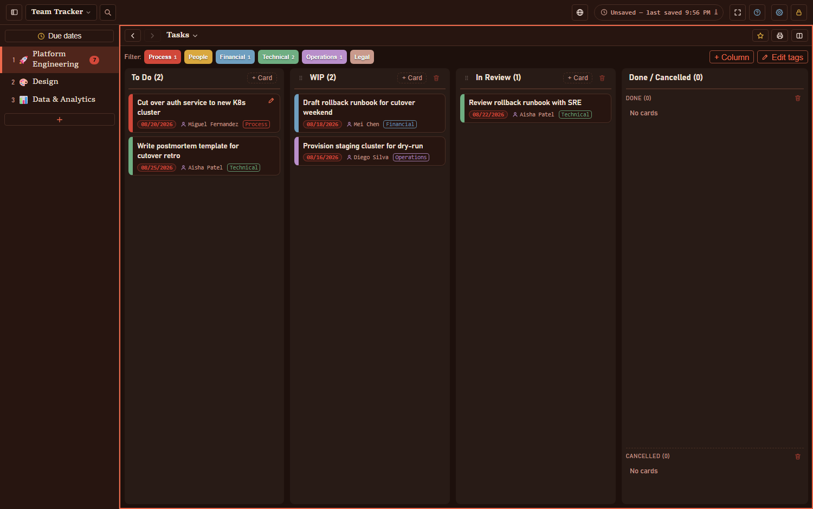
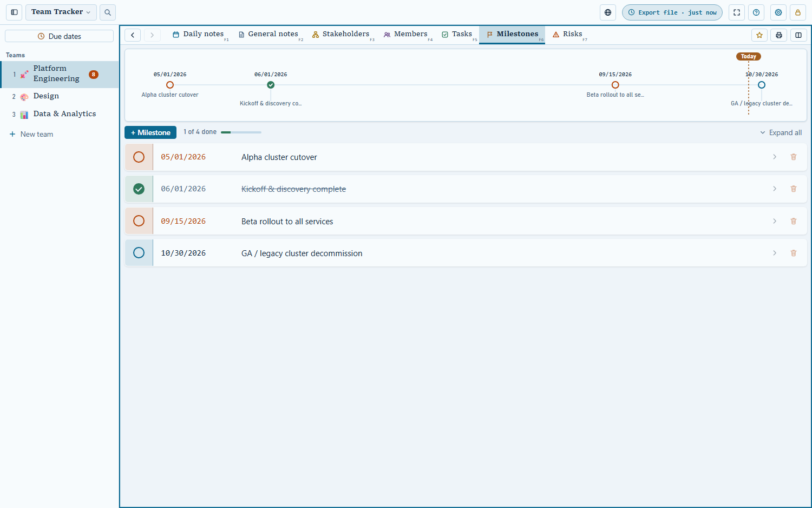
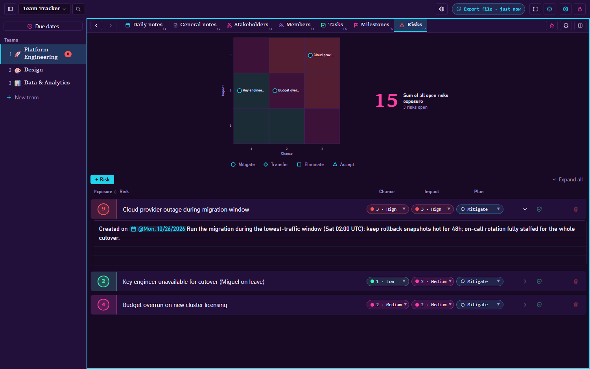
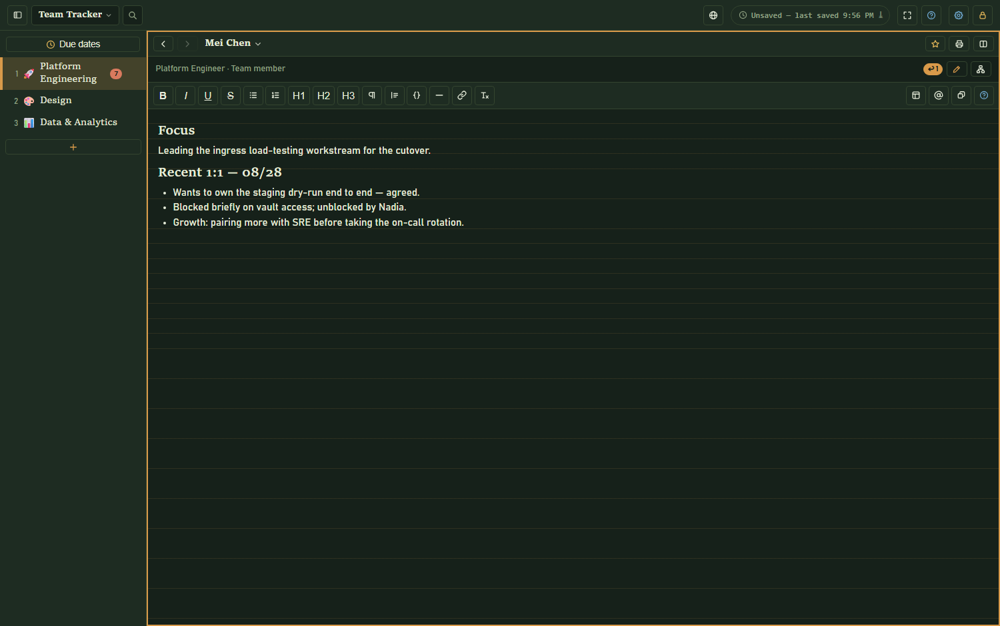
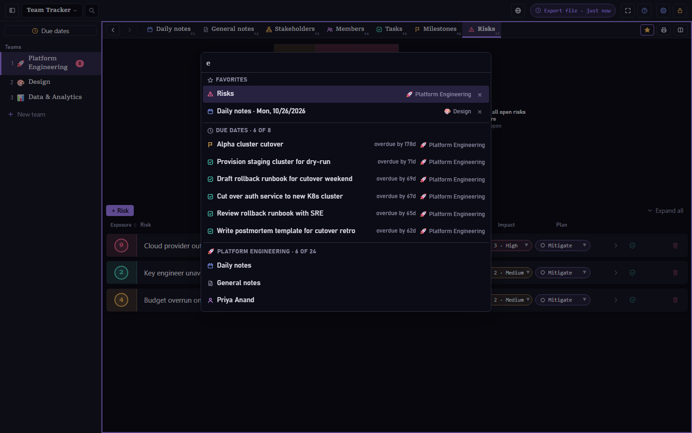
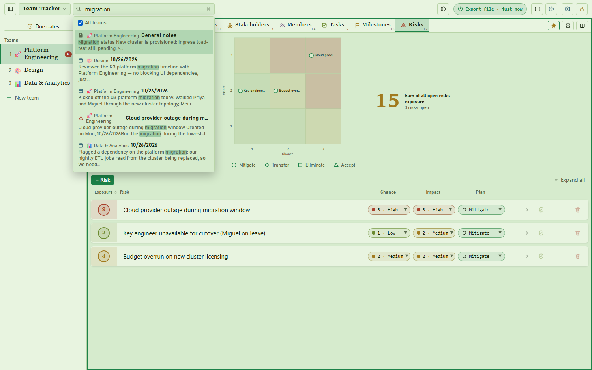

# Team Tracker

A zero-runtime-dependency, single-file web app for tracking teams: people and
hierarchy, daily/per-person notes, tasks, milestones (with a calendar
view), and risks.

**[Try it now](https://fmpallini.github.io/team-tracker/)** — runs entirely in
your browser, nothing to install.

### A one-minute tour

Re-organise an org chart by drag, double-click a person to open their notes,
write rich text with shortcuts or markdown, switch between fully separate
teams, jump to any module, item or favorite in any team with Fast Switch
(`Ctrl+Shift+K`), follow `@`-references
(plain click jumps to the item, `Ctrl`+click opens it in the second pane),
drop in one-key templates, run a kanban board with custom columns, drag a risk
on the chance × impact chart to re-score it, and switch to dark mode.



[▶ Watch with sound](https://github.com/fmpallini/team-tracker/blob/main/docs/videos/feature-tour-short.webm)
(the GIF is silent; GitHub can't embed `<video>` in a README, so this link
opens the same clip in its own player).

<details>
<summary>More screenshots</summary>

| | |
|---|---|
|  |  |
| Daily notes + team hierarchy | Rich text — shortcuts + markdown |
|  |  |
| Tasks — kanban with custom columns | Milestones — timeline + list |
|  |  |
| Risks — chance × impact exposure | Per-person notes + backlinks |
|  |  |
| `Ctrl+Shift+K` fast switch | `Ctrl+Shift+F` search across every team |

</details>

## Why

Team Tracker is a personal note-taking app for people who lead several teams
and work on their own: your notes on people, 1:1s, tasks, milestones,
and risks, kept private to you. It's deliberately not a collaboration tool —
there's no online sharing and no shared workspace.

It's a free alternative to Notion, Obsidian, or any note-taking app — free as
in price, and free as in freedom: it's AGPL-3.0, and the whole app is a single
HTML file you can read end to end. It doesn't try to match those tools feature
for feature; it does one thing, tracking several teams at once.

Most team-tracking tools require an account, a server, and your data leaving
your machine. Team Tracker doesn't:

- 🔌 **100% offline** — nothing leaves your machine (the one optional
  exception is a [daily update check](#privacy-and-updates)).
- 🗄️ **A single `.tmv` file** you keep wherever you want — copy it, back it up,
  sync it. No vendor stores it for you
  ([details](#your-data)).
- 🔒 **Encrypted by default, optionally not** — AES-256 with your password, or
  a password-less plain-text file if you'd rather skip the overhead.
- 🪶 **Tiny** — the entire app is one HTML file, with no dependencies
  ([why that matters](#zero-runtime-dependencies)).
- ⌨️ **Keyboard-first** — `Ctrl+Shift+K` fast switch, `Ctrl+F` /
  `Ctrl+Shift+F` search, `Alt+1`…`Alt+9` team switching, `Alt+Shift+←/→` pane
  history, split-view panes, and shortcuts for every module. Desktop-only by
  design: phones and tablets get a notice instead of the app, since mobile
  browsers lack the File System Access API the open/save flow depends on.
- 🎨 **Yours to tune** — 12 color palettes, light/dark/system theme, 7 font
  stacks, adjustable font size, and pt-BR/en-US locales, all in Settings.

## Getting started

### Web app (installable)

**<https://fmpallini.github.io/team-tracker/>** is always the latest release.
Chrome and Edge offer to install it as a local app with its own window, and it
**updates automatically** whenever a new version is released.

### Local file

Download `team-tracker-X.Y.Z.html` from the
[latest release](https://github.com/fmpallini/team-tracker/releases/latest)
(expand **Assets** at the bottom of the release notes), or build it yourself
— see [CONTRIBUTING.md](CONTRIBUTING.md); it lands in `dist/app.html`. Then
double-click it or open it from your browser's file picker. No install, no
server: the whole app (HTML, CSS, JS) lives in that one file.

To open it in its own app-like window (no address bar or tabs), launch Chrome
with the `--app` flag:

```
chrome --app="file:///C:/path/to/team-tracker.html"
```

Keep the quotes — they protect paths with spaces or special characters. On
Linux, drop the drive letter and use `google-chrome`
(`--app="file:///path/to/team-tracker.html"`); on macOS, use
`open -na "Google Chrome" --args --app="file:///path/to/team-tracker.html"`.
For Edge, swap in `msedge` (`microsoft-edge` on Linux, `"Microsoft Edge"` on
macOS). The app's own help dialog (the help button in the header) shows the
exact command for your browser, ready to copy.

## Your data

Your work lives in two places: a single `.tmv` file that you create, open and
keep, and a live copy of the open document that your **browser** holds for you.
Team Tracker never uploads or syncs either. **You own the file and are
responsible for backing it up** — losing it, or forgetting its password, means
the data is unrecoverable.

**How saving works.** Every edit goes to the browser's own storage (IndexedDB)
within a fraction of a second — only the part that changed, never the whole file.
The `.tmv` file is a snapshot, written at three moments: when you open a file
whose browser copy is ahead of it, when you close the file with the lock button
(`Ctrl+Alt+L`), and on a timer (every hour by default; 1 to 24 hours in Settings →
Saving). There is no Save command, and `Ctrl+S` does nothing. **Close with the lock
button:** it writes the file before the document is released, so it is the one way
to be sure the file is current. The save indicator reports whether the app *can*
write the file, not whether it is up to date: "Saved" means the browser copy is
current; hover it to see when the file was last written and when the next write is
due.

**What a browser can lose.** The browser copy lives in your browser profile on this
device. Clearing site data, or using a private window, removes it — and with it any
work not yet written to the file. If the browser has not promised to keep its
storage, the indicator's hover and Settings → Saving say so. This is also why the
file matters: it is what you can copy, sync and restore.

**Encryption.** By default the file is AES-256-GCM encrypted, decrypted only on
your device, and the browser copy of a password-protected file is encrypted too,
with the same key: nothing readable is left in the browser's storage. Alternatively
choose "Create without password" at creation, or Settings → Security → "Migrate to
password-less" later; you can set a password on a password-less file at any time
from the same tab. The trade-off: anyone with access to a password-less file —
including a cloud provider's automated scanning — can read it as plain text.

**When the file can't be written** (permission lost, disk full, file locked) the
indicator turns amber or red and says so. Your changes stay safe in the browser.
Clicking the indicator, or closing the file, offers the way out: grant access again,
download a copy right now, try again, or close anyway — the browser keeps your work
and the next open reconciles the file with it.

**Opening a file that has a browser copy.** The app compares them by identity, not by
dates: the same write means nothing to do; a browser copy that is ahead is loaded and
the file is rewritten; a file that is an older version of what this browser produced
(say, restored from cloud history) asks which to keep; a file that changed elsewhere
while the browser also has unwritten edits asks which to keep; a file that simply
came from elsewhere wins.

Pictures you add to notes live inside the same `.tmv` file (and are encrypted with
the same key); there is no separate image folder to keep together. See the
[FAQ](#faq) for what is accepted and how pictures are shrunk.

### Backing up

Team Tracker has no backup service and doesn't need one, and it does not write a
second backup file. Keep your `.tmv` in a folder synced by any cloud client ([Google
Drive for desktop](https://workspace.google.com/products/drive/#download), OneDrive,
Dropbox): that folder is your backup, with either build.

- **Privacy is preserved** — the file is encrypted before it touches disk, so
  the provider only ever sees ciphertext.
- **Available anywhere** — download it from the provider's web UI on any
  machine and open it with the app.
- **Version history for free** — most providers keep earlier versions of a
  synced file for a while (Google Drive: ~30 days). This is the only way to
  recover an earlier state. The app itself keeps no version history; its only
  undo is the ten-second notice after deleting an item.
- **The file is written hourly, not on every edit** — so the provider's history has
  one version per write (open, close, timer), not one per keystroke.

## Privacy and updates

No analytics, no telemetry, ever. The app makes exactly one network call, in
both build variants: once a day it fetches
`https://api.github.com/repos/fmpallini/team-tracker/releases/latest` (a public,
unauthenticated read — nothing about you or your data is sent) and shows a
banner if a newer version is out. It's purely informational; the app never
downloads or installs anything by itself.

- **Web app**: the banner offers "Reload now", which has the already-updated
  service worker take over.
- **Local file**: a static `file://` page can't self-update, so the banner
  links to the releases page for you to download the new file.

Dismissing the banner silences it for that version. There's no preference to
turn the check off entirely.

## Zero runtime dependencies

The app ships as one HTML file with CSS and JS inlined — open it years from
now, on any machine, with any browser, and it still works exactly as built.
That only holds if nothing at runtime depends on a third-party library that
could have a vulnerability, an abandoned maintainer, or a breaking major
version. `esbuild`, `typescript`, `vitest`, `jsdom`, and `@playwright/test` are
dev-only tooling; none of their code ships in the build. It's a hard project
constraint: no runtime dependency is ever added, however small.

It also shrinks the supply-chain attack surface to what's in the build output,
which you can read end to end. Every release is also signed with a build
provenance attestation — see [Verifying a release](docs/VERIFYING.md).

## FAQ

**Where do notes or tasks go if they aren't about one specific team?**
Every module is scoped to a team. For org-wide stuff, make a dedicated team —
e.g. `🌐 General` or `🔗 Cross-team` — and use its General Notes / tasks.
Global search (`Ctrl+F`, or all teams with `Ctrl+Shift+F`) finds it alongside
everything else.

**Can I use this for just myself, not an actual "team"?**
Yes. A "team" is just a grouping — one person, one project, one client,
whatever's useful. Nothing about the app assumes multiple people.

**How many teams can I have?**
No hard limit. `Alt+1`…`Alt+9` quick-switches the first nine; beyond that, use
the sidebar.

**How does saving work? When is my `.tmv` file written?**
The browser holds the live copy and the file is a snapshot of it. Your edits reach the
browser within a fraction of a second. The file is written when you open a file whose
browser copy is ahead of it, when you close it with the lock button (`Ctrl+Alt+L`),
and every 1–24 hours (Settings → Saving, one hour by default). There is no Save
command. Close with the lock button: it is the only thing that guarantees a file write
before the document is released.

**What do I lose if I clear my browser data?**
Whatever was not yet written to the file: the work since the last file write, up to
the timer interval. Clearing site data (or closing a private window) deletes the
browser copy. Everything written to the file is safe. When the browser has not
promised to keep its storage, the save indicator's hover and Settings → Saving say so.

**What happens if the file can't be written?**
The indicator says why ("Grant access" or "File not written") and your changes stay
safe in the browser. Closing the file then shows a dialog: grant access again,
download a copy of the document right now, try again, or close anyway — the browser
keeps your work, and the next time you open the file the app reconciles the two. If you
close the window without Lock/Close you get the browser's "leave site?" warning only
when the file is overdue (older than the timer interval).

**Why a Chromium-based browser?**
Chrome, Edge, Brave and the like can write the `.tmv` file silently and ask again if
the permission lapses, so the file stays current without downloads. Browsers without
the File System Access API (Firefox, Safari) still work: the browser copy takes every
edit, but the file can only be written by hand — the save indicator becomes an
always-clickable "Export file · 3 h ago" button that downloads a `.tmv`, turning
amber once the last export is older than the timer interval. No automatic file writes
happen there.

**Can multiple people edit the same file, or can I use it across devices?**
Not simultaneously — it's one manager's tracking tool, not a shared workspace.
In the same browser, a second tab (or the installed app next to a browser tab)
is automatically read-only with a "take control" button. Across browsers or
computers (say, a synced copy on Google Drive), the app checks whenever it writes
the file: if the file changed elsewhere since you opened it, you choose between
reloading the newer version, saving yours as a new file, and writing yours over it.
One browser on one device is the supported use: each browser keeps its own copy of
the document, so there is no multi-device or multi-browser sync — a `.tmv` in a
cloud-synced folder is a backup, not a sync channel. Phones aren't supported (see
[Why](#why)).

**What happens if I forget my password?**
No recovery: the key is derived from the password, and nobody (including the
app's author) can decrypt the file without it. Use a password manager.

**How secure is the encryption — could someone brute-force my password?**
Keys come from PBKDF2-SHA256 at 600,000 iterations, deliberately expensive so
guessing against a stolen file is slow even on dedicated hardware. The real
variable is your password: 10+ characters (mixed case, numbers, symbols; not a
dictionary word or a reused password) would take a regular computer far longer
than a human lifetime. Short or common passwords are much weaker. Since there's
no "forgot password" recovery, generate and store it in a password manager.

**Can I import an org chart from a CSV or HR system?**
No bulk import. The only import/export is team-to-team: export a team's
people/hierarchy (no notes, tasks, milestones, or risks) so a teammate
can import it — see the Data tab in preferences.

**Can I put pictures in my notes?**
Yes. Paste a screenshot or copied image (also mixed with text), drag image files
onto a note, or use the picture button in the editor toolbar. Pictures sit on
their own line, centered, at their natural pixel size (never scaled by the font
size or zoom; wider than the pane, they shrink to fit), with a blank line above
and below. Click one and press Backspace or Delete to remove it. They are stored
inside the `.tmv` file, encrypted like everything else, and a picture no note
uses any more is dropped from the file the next time it is written.

- **Formats:** PNG, JPEG, WebP, GIF, AVIF and BMP. Recognized by their content,
  not their file extension. Not supported: SVG, HEIC/HEIF, TIFF, JPEG XL, ICO,
  or anything that is not an image. Pictures pasted as links from a web page
  are not fetched; copy the image itself instead.
- **Shrinking:** every picture is re-encoded in your browser to WebP, with its
  longest side capped at 1600 px, and must end up at **1 MB or less**. If it is
  still too big the quality is lowered in steps, then the picture is scaled down
  further, but never below 800 px on its longest side; if it still does not
  fit, it is refused and you are told. Pictures are never enlarged. A WebP that
  already fits is kept untouched.
- **Animated GIF, APNG and animated WebP** keep their animation, so they are
  stored exactly as they are and must be 1 MB or less (otherwise refused).
- **Total budget:** 150 MB of pictures per file, counted on the pictures your
  notes actually use. You get a warning at 100 MB and a message with a "Show
  usage" shortcut (Preferences → Data) when the limit is reached; there is no
  limit on the number of pictures. The browser copy stores each picture once, when it
  is added, but every file write includes all of them, so a file full of pictures
  takes longer to write, which is why the budget exists.
- **Same picture twice** is stored once.
- **Older versions:** a file saved by this version cannot be opened by Team
  Tracker releases before 3.2.0.

**Does it send reminders or notifications for due dates?**
No push or email. Due and overdue items show up inside the app — sidebar and
header badges, the due list, the "Due dates" group in Fast Switch, kanban
highlighting — and, in the installed app, as a count on its OS icon badge where
the OS supports it. Nothing alerts you while the app is closed.

**Is the "clean up" button in preferences safe to click?**
It's irreversible (no undo, unlike deleting a single item) and deliberately
cross-team. Across **all** teams in the file it permanently deletes every
done/cancelled task and closed risk, completed milestones and daily notes older
than the day count you set, and any favorites left pointing at something gone.
It shows the exact counts before you confirm — read them first.

## Contributing

- Build & local development — **[CONTRIBUTING.md](CONTRIBUTING.md)**
- How the code is organised — **[docs/ARCHITECTURE.md](docs/ARCHITECTURE.md)**
- Adding a new module/pane — [CONTRIBUTING.md § Adding a new module/pane](CONTRIBUTING.md#adding-a-new-modulepane)
- What changed in each version — [CHANGELOG.md](CHANGELOG.md)
- Local git hooks and the checks CI runs — [.githooks/README.md](.githooks/README.md)
- Checking that a release was built by this repo's workflow — [docs/VERIFYING.md](docs/VERIFYING.md)

## License

AGPL-3.0. See [LICENSE](LICENSE).
